# Awesome CLI File Viewers & Syntax Highlighting Ecosystem 🚀

<div align="center">



<p align="center">
  <a href="https://github.com/ishandutta2007/Awesome-Awesome-Awesome"></a>
  <a href="https://discord.gg/jc4xtF58Ve"></a>
  <a href="https://github.com/ishandutta2007/Awesome-CLI-File-Viewers-Syntax-Highlighting/stargazers"></a>
  <a href="https://github.com/ishandutta2007/Awesome-CLI-File-Viewers-Syntax-Highlighting/network/members"></a>
  <a href="https://github.com/ishandutta2007/Awesome-CLI-File-Viewers-Syntax-Highlighting/issues"></a>
  <a href="https://github.com/ishandutta2007/Awesome-CLI-File-Viewers-Syntax-Highlighting/blob/main/LICENSE"></a>
  <a href="https://github.com/ishandutta2007"></a>
</p>

**Curated List of SaaS / Hosted Platforms & Open-Source Terminal Utilities 💻✨**  
*The ultimate index of modern CLI pagers, syntax-highlighted file viewers, terminal Markdown renderers, AST diff tools, fuzzy preview finders & cloud shells.*

**Last updated: November 2026** 📅

</div>

---

## 📖 Introduction & Ecosystem Overview

Welcome to the **Awesome CLI File Viewers & Syntax Highlighting** repository! 🌟

Command-line interfaces (CLIs) and terminal workflows have undergone a modern renaissance. Developers, SREs, and DevOps engineers increasingly rely on high-performance utilities written in **Rust**, **Go**, and **C** to inspect, highlight, paginate, diff, fuzzy-search, and render source code, Markdown files, logs, JSON/YAML payloads, and structured datasets directly within local terminals, remote SSH sessions, and cloud shell workspaces.

Whether you need a drop-in `cat(1)` replacement with Git diff gutter flags like `bat`, an interactive AST syntax diff viewer like `difftastic`, or a cloud-hosted development shell like `GitHub Codespaces`, this guide gathers the most powerful SaaS platforms and open-source tools with up-to-date benchmarks, pricing models, and direct repository links.

---

## 📑 Table of Contents

- [📊 Sector Overview & Market Dynamics](#-sector-overview--market-dynamics)
- [☁️ SaaS / Hosted Platforms](#️-saas--hosted-platforms)
- [🛠️ Open-Source GitHub Projects](#️-open-source-github-projects)
  - [Top Projects (Ranked by Stars)](#top-projects-ranked-by-stars)
  - [Recommended Workflows & Pipelines](#recommended-workflows--pipelines)
- [🤝 How to Contribute](#-how-to-contribute)
- [💖 Support & Share](#-support--share)
- [📈 Star History](#-star-history)
- [⚖️ Disclaimer](#️-disclaimer)

---

## 📊 Sector Overview & Market Dynamics

The global cloud developer environments, terminal tooling, and code intelligence sector is estimated at **$7.5B to $8.6B** (expanding at an estimated 15–23% CAGR). The market exhibits a **moderately fragmented yet bifurcated dynamic**: foundational hyperscalers (Microsoft, Alphabet, Amazon) dominate enterprise cloud shell and remote workspace hosting, while specialized terminal emulator, code search, and developer workflow innovators (such as Warp, Sourcegraph, and Gitpod) capture high-growth niches around AI-assisted developer velocity.

---

## ☁️ SaaS / Hosted Platforms

| Platform | Company Valuation / Revenue | Starting Paid Tier Pricing | Free Tier / Trial Limits | Description |
| :--- | :--- | :--- | :--- | :--- |
| **[Google Cloud Shell](https://cloud.google.com/shell)** | **Alphabet: ~$2.1T+ Valuation** (~$350B+ Ann. Revenue) | $0.00 (Standard shell included free with Google Cloud account; pay standard GCE rates only for custom VM attachments) | **Free forever**: 50 hours of Cloud Shell usage per week per user, plus 5 GB persistent home directory storage. | Managed cloud CLI and web code editor featuring persistent home storage, built-in syntax highlighting, and pre-configured terminal tools for inspecting cloud configs. |
| **[AWS CloudShell](https://aws.amazon.com/cloudshell/)** | **Amazon: ~$2.0T+ Valuation** (~$600B+ Ann. Revenue) | $0.00 (Standard shell included at no additional charge with AWS Account; standard AWS resource fees apply if accessing VPCs/S3) | **Free forever**: Up to 10 concurrent shells per AWS region, 1 GB persistent storage per region, and 20-minute inactivity auto-stop. | Browser-based, pre-authenticated cloud terminal environment providing instant POSIX shell access with pre-installed `vim`, `nano`, `less`, and `git` utilities. |
| **[GitHub Codespaces & Web Editor (`github.dev`)](https://github.com/features/codespaces)** | **Microsoft / GitHub: ~$3.1T+ Valuation** (~$1B+ GitHub ARR) | $0.18/hour (2-core compute) + $0.07/GB/month (storage) or Team plan starting at $4.00/user/month | **Free forever**: 60 core-hours of compute and 15 GB of Codespaces storage per month for all GitHub Free personal accounts; `github.dev` web editor is 100% free with unlimited hours. | Cloud-hosted development and browser terminal environment pre-equipped with modern CLI file viewers (`bat`, `ripgrep`, `fzf`, `vim`) and syntax-highlighted file inspection. |
| **[Sourcegraph Cloud](https://sourcegraph.com)** | **Sourcegraph: ~$2.6B Valuation** (~$50M ARR) | $16,000/year (Enterprise baseline annual commitment for production engineering teams) | **Sales-assisted trial**: Discontinued public self-serve free tier; provides a custom enterprise Proof-of-Concept (PoC) / 14-day to 30-day trial upon sales coordination. | Cloud code intelligence and universal code search platform offering hosted Ripgrep-powered regex search and syntax-highlighted cross-repository file browsing. |
| **[Warp Cloud (Warp Terminal)](https://warp.dev)** | **Warp: ~$300M+ Valuation** (~$16M ARR) | $20.00/user/month ($18/month billed annually) on the Build tier | **Free forever**: Full core terminal functionality, 3 indexed codebases (up to 3,000 files each), 30 cloud conversations, 10 shared workflows, and unlimited BYOK (Bring Your Own Key) for AI agents (0 bundled Warp AI credits). | Modern GPU-accelerated terminal featuring cloud-synced workflows, block-based command output inspection, syntax highlighting, and integrated file viewing. |
| **[Gitpod / Ona Cloud Environments](https://gitpod.io)** | **Gitpod: ~$100M+ Valuation** (~$38M total funding raised) | $9.00/user/month (Pay-As-You-Go / Starter tier with 1,000 credits) | **Free forever**: 500 credits per month (~50 hours of standard workspace compute) across public and private GitHub/GitLab repositories. | Ephemeral cloud developer workspaces delivering browser-accessible terminals and reproducible dotfiles setups (`bat`, `eza`, `delta`, `neovim`) out of the box. |
| **[Carbon (`carbon.now.sh`)](https://carbon.now.sh)** | **Carbon: Bootstrapped / Community Project** (<$1M valuation) | $0.00 (100% free open-source community tool; optional community GitHub/Open Collective sponsorships) | **Free forever**: Completely free and unlimited syntax-highlighted code snippet exports and image generation with no account or paywall required. | Hosted web platform and CLI-integrable service for turning source code snippets into beautifully syntax-highlighted images and shareable embeds. |

---

## 🛠️ Open-Source GitHub Projects

This section tracks premier open-source terminal file viewers, syntax highlighters, fuzzy finders, AST diff engines, and terminal file managers.

Sorted in descending order by GitHub Stars ⭐. Every star badge links directly to that repository's stargazers page.

### Top Projects (Ranked by Stars)

- **[Neovim](https://github.com/neovim/neovim)** [](https://github.com/neovim/neovim/stargazers) ⚡  
  Vim-fork focused on extensibility and usability, featuring built-in Tree-sitter syntax highlighting, asynchronous Lua scripting, LSP client, and headless read-only pager mode (`nvim -R`).

- **[fzf](https://github.com/junegunn/fzf)** [](https://github.com/junegunn/fzf/stargazers) 🔍  
  Blazing-fast, portable general-purpose command-line fuzzy finder written in Go with real-time interactive preview windows powered by `bat`, `glow`, or custom viewer scripts.

- **[Ripgrep](https://github.com/BurntSushi/ripgrep)** [](https://github.com/BurntSushi/ripgrep/stargazers) ⚡  
  Line-oriented search tool written in Rust that recursively searches directories for regex patterns while respecting `.gitignore`, outputting ANSI syntax-highlighted matching lines.

- **[Bat](https://github.com/sharkdp/bat)** [](https://github.com/sharkdp/bat/stargazers) 🦇  
  Flagship open-source `cat(1)` clone written in Rust with TextMate syntax highlighting, automatic pagination via `less`, Git diff gutter indicators, and non-printable character display.

- **[Helix](https://github.com/helix-editor/helix)** [](https://github.com/helix-editor/helix/stargazers) 🧬  
  Modern post-modern modal terminal text editor and viewer written in Rust with built-in Tree-sitter syntax highlighting, multiple selections, and zero-config LSP support.

- **[fd](https://github.com/sharkdp/fd)** [](https://github.com/sharkdp/fd/stargazers) 📂  
  Simple, fast, and user-friendly alternative to `find(1)` written in Rust, featuring colorized terminal output by file type, regex matching, and parallel directory traversal.

- **[Yazi](https://github.com/sxyazi/yazi)** [](https://github.com/sxyazi/yazi/stargazers) 🦆  
  Blazing-fast terminal file manager written in Rust based on non-blocking async I/O, featuring built-in syntax-highlighted code previews, image rendering, and `fzf`/`ripgrep` search integration.

- **[Vim](https://github.com/vim/vim)** [](https://github.com/vim/vim/stargazers) 📝  
  Ubiquitous modal Unix text editor and terminal file inspector with syntax coloring for hundreds of programming languages, regex search, and standard terminal paging.

- **[btop](https://github.com/aristocratos/btop)** [](https://github.com/aristocratos/btop/stargazers) 🖥️  
  Modern, responsive terminal monitor written in C++ featuring real-time syntax-colored process inspection, disk I/O trees, and system resource visualization.

- **[Delta](https://github.com/dandavison/delta)** [](https://github.com/dandavison/delta/stargazers) 🔀  
  Syntax-highlighting pager for `git`, `diff`, `grep`, and `blame` output written in Rust with side-by-side split diffs, word-level changes, and configurable themes.

- **[Micro](https://github.com/zyedidia/micro)** [](https://github.com/zyedidia/micro/stargazers) 🔬  
  Modern, intuitive terminal-based text editor and file viewer written in Go with full mouse support, standard keybindings, splits, and 130+ syntax themes.

- **[Glow](https://github.com/charmbracelet/glow)** [](https://github.com/charmbracelet/glow/stargazers) 🌟  
  Terminal-based Markdown reader and CLI renderer written in Go by Charm, featuring Glamour syntax highlighting, interactive TUI directory browsing, and stash syncing.

- **[Difftastic](https://github.com/Wilfred/difftastic)** [](https://github.com/Wilfred/difftastic/stargazers) 🌳  
  Structural, AST-aware diff tool that compares source code files using Tree-sitter syntax parsing rather than naive line-by-line comparison, displaying syntax-highlighted semantic diffs.

- **[Superfile](https://github.com/yorukot/superfile)** [](https://github.com/yorukot/superfile/stargazers) 📁  
  Fancy, modern terminal file manager written in Go with dual-pane browsing, hotkeys, file previews, and embedded syntax highlighting.

- **[Eza](https://github.com/eza-community/eza)** [](https://github.com/eza-community/eza/stargazers) 🗂️  
  Modern, actively maintained open-source replacement for `ls` written in Rust featuring color-coded file formats, Git status integration, tree views, symlink targets, and Nerd Font icons.

- **[fx](https://github.com/antonmedv/fx)** [](https://github.com/antonmedv/fx/stargazers) 🧩  
  Terminal JSON viewer and interactive streaming tool written in Go with collapsible tree exploration, mouse support, JavaScript/Python transforms, and syntax highlighting.

- **[Ranger](https://github.com/ranger/ranger)** [](https://github.com/ranger/ranger/stargazers) 🏹  
  Console file manager with VI keybindings written in Python featuring multi-column Miller columns and an integrated syntax-highlighted file preview pager.

- **[jless](https://github.com/PaulJuliusMartinez/jless)** [](https://github.com/PaulJuliusMartinez/jless/stargazers) 📑  
  Command-line JSON and YAML viewer written in Rust with syntax highlighting, vim-style navigation, regex searching, and structural breadcrumb inspection.

- **[Chroma](https://github.com/alecthomas/chroma)** [](https://github.com/alecthomas/chroma/stargazers) 🎨  
  General-purpose syntax highlighting library and CLI utility in Go, heavily inspired by Pygments, powering terminal formatters and tools like `glow`.

- **[ov](https://github.com/noborus/ov)** [](https://github.com/noborus/ov/stargazers) 📜  
  Feature-rich terminal pager written in Go supporting multi-color highlighting, column mode, CSV table alignment, section header pinning, and mouse navigation.

- **[GNU Less](https://github.com/gwsw/less)** [](https://github.com/gwsw/less/stargazers) 📟  
  The foundational open-source terminal pager utility supporting forward/backward scrolling, regex search, ANSI color pass-through (`less -R`), and `lesspipe` syntax filters.

---

### Recommended Workflows & Pipelines 🔧

Build a world-class terminal developer environment by combining these utilities:

```bash
# 1. Fuzzy file search with instant live syntax-highlighted preview
fzf --preview 'bat --style=numbers --color=always --line-range :500 {}'

# 2. Syntax-highlighted git diff with side-by-side view
git config --global core.pager "delta"
git config --global interactive.diffFilter "delta --color-only"

# 3. Structural, AST-aware semantic diff
GIT_EXTERNAL_DIFF=difft git diff

# 4. Colorized tree view of directory hierarchy
eza --tree --level=3 --icons --git

# 5. Render local markdown documentation in terminal
glow README.md -p
```

---

## 🤝 How to Contribute

Contributions are warmly welcomed! Help keep this ecosystem guide comprehensive and up-to-date:

1. 🍴 **Fork the repository** on GitHub.
2. 🌿 **Create a new branch** (`git checkout -b feature/add-new-cli-tool`).
3. 📝 **Add your tool** to `README.md` following the established format:
   - Name and link
   - GitHub stars badge linked to stargazers
   - Concise 1–2 sentence description of syntax viewing capabilities
4. 📬 **Submit a Pull Request** with a descriptive summary of the project.

---

## 💖 Support & Share

If you find this curated list helpful, please consider supporting the project:

- ⭐ **Star this repository** to help other developers and DevOps engineers discover it.
- 🍴 **Fork & Share** it with your engineering team, peers, or communities on X/Twitter, LinkedIn, and Reddit.
- ☕ **Buy me a coffee / Sponsor** my open-source work on [GitHub Sponsors](https://github.com/sponsors/ishandutta2007) — every bit of sponsorship supports continuous maintenance, ecosystem tracking, and open-source tooling!

<p align="center">
  <a href="https://github.com/sponsors/ishandutta2007">
    
  </a>
</p>

---

## 📈 Star History

[](https://www.star-history.com/#ishandutta2007/Awesome-CLI-File-Viewers-Syntax-Highlighting&type=date&legend=top-left)

---

## ⚖️ Disclaimer

- This is an independent **community-curated** list — not an official endorsement.
- All trademarks, logos, and service marks belong to their respective corporate and open-source entities.
- Exercise standard security precautions when viewing untrusted binary or shell files containing malicious ANSI escape sequences; always use safe flags (e.g. `bat`, `less -R`) in production environments.

---

<div align="center">
  <sub>Crafted with ❤️ for the global CLI developer &amp; open-source community.</sub>
</div>
